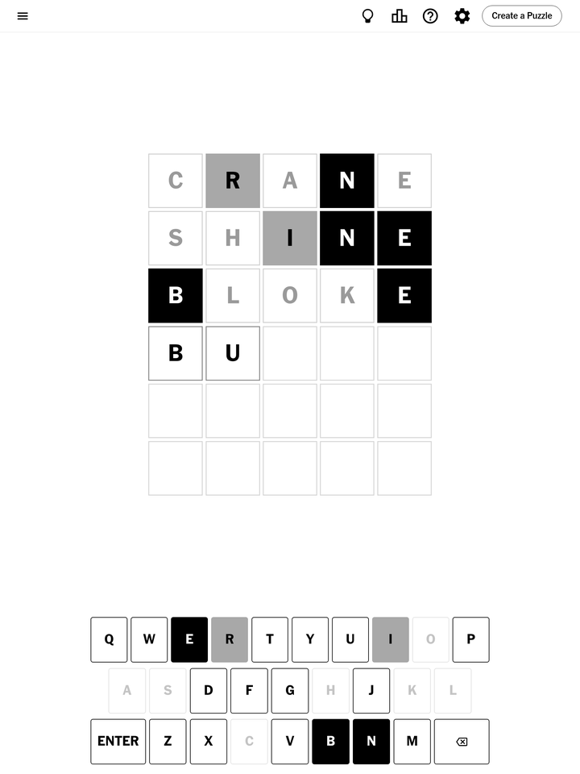

# NYT Games for Supernote

An unofficial little Android app that runs the New York Times games on a Supernote e-ink tablet (Manta, Nomad), tuned for a greyscale screen.

It opens the NYT games pages and their hint pages, and nothing else: no news, no other sites, no ads or trackers. Free games work as they are; sign in with your own NYT account for the rest.

Not made by or affiliated with The New York Times. You need your own NYT Games subscription for the games that require one.

<p align="center">
  
  &nbsp;
  
</p>
<p align="center"><sub>Screenshots from a Supernote Manta. Crossword: big grid and the two current clues. Wordle (example guesses): black = right spot, grey = wrong spot, faded = not in the word.</sub></p>

## What it changes

- **Crossword and Mini:** the full clue lists are hidden so the grid can be big. The current Across and Down clues sit under the grid in large type; tap one to switch. Highlighted squares use greys the e-ink panel shows clearly.
- **Wordle:** green and grey look almost the same on e-ink, so tiles are **black** for the right spot, **grey** for the wrong spot and **white with a faded letter** for "not in the word". The keyboard matches, and the board and keys are bigger.
- **Spelling Bee:** the centre letter is black, so it stands out.
- **Strands:** the letters you're tapping are black, the spangram dark grey, theme words mid grey.
- **Connections:** bigger on the Manta. Solved groups go from light grey (easiest) to dark (hardest), with 1–4 dots for difficulty.
- **Pips:** a much bigger board, and each coloured region gets its own grey, stripes or dots so you can tell them apart.
- **Sudoku:** the selected square is black, and its row, column and box a clear grey.
- **Letter Boxed:** a darker background so the white letters stand out.
- Text is never shrunk below 100% (Supernote's system font setting otherwise shrinks every web page).
- **Hints:** each game's hint button (the lightbulb) opens its hint page, with a big **← Back to the game** bar at the bottom.
- **The bots:** "Did you beat the bot?" opens WordleBot or Connections Bot, with the same **← Back to the game** bar.
- **Connections: Sports Edition** opens from NYT's games menu.
- **Getting around:** a small **Games** button at the top of every game goes back to the main games page.
- **No ad leftovers:** empty ad boxes, "Continue to…" ad screens and the bottom promo banners (app downloads, gift subscriptions) are removed.
- **No Crossplay:** it only plays in NYT's phone app, so its links and pictures are hidden.
- **Faster starts:** a loading screen shows straight away, and the games appear in about 5 seconds instead of 12. NYT's news-site background script, which slowed every start, is turned off, and NYT's pictures and fonts are kept on the tablet after the first load.
- A link to something outside the games (news, subscriptions) stays put and says **Not in this app**.
- If Wi-Fi is off, you get a "No connection" page with **Try again** and **Close**. It reloads by itself when Wi-Fi comes back.

## Install (about 5 minutes, no coding)

The easy way, from Chrome or Edge on a computer:

1. **On the Supernote:** Settings → Security & Privacy → turn on **Sideloading**.
2. Plug the Supernote into your computer with its USB cable.
3. Go to **[ell.ing/nyt-games](https://ell.ing/nyt-games/)** and click **Install NYT Games**.
4. Pick the Supernote in the box that opens, and tap **Allow** on the Supernote if it asks.

### Or with Android Sideloader (Safari, Firefox, or if the page can't reach the Supernote)

1. **Download** `NYT-Games.apk` from the [Releases page](../../releases/latest).
2. **On the Supernote:** Settings → Security & Privacy → turn on **Sideloading**.
3. **On your computer** (Mac, Windows or Linux): install [Android Sideloader](https://github.com/ryan-andrew/android_sideloader/releases).
4. Plug the Supernote in with its USB cable and open Android Sideloader.
5. Click **Choose APK file**, pick `NYT-Games.apk`, then **Install APK**.

### Updating

Install the newer version the same way, from the page or with Android Sideloader.
Your login and puzzles are kept.
(Version 1.1 was called Crossword; 1.2 installs over it.)

## Signing in

The free games work without signing in.

To play the subscriber games (like the daily Crossword) or keep your streaks, sign in to your NYT account (menu ☰ → Log in).
You stay signed in after that.

**Normally sign in with Google, Apple or Facebook?** Those buttons won't work in this app.
Type your account's email address instead, and choose to get a **one-time code by email**.
Enter the code from your inbox. It signs you in to the same account.

## Tips

- NYT sometimes shows a **Play** screen first; tap Play to continue where you left off.
- Use the ☰ menu to switch between games.
- The Back button goes back a page, and closes the app on the first page.

## Known limits

- Supernote's built-in web engine is an old Chrome (96) that can't be updated. The app patches around what NYT's site needs from newer Chrome, but an NYT redesign could break a game until the app is updated.
- Built and tested on a **Manta**. The **Nomad** layout was tested by simulating its screen size on a Manta. Reports from Nomad owners are very welcome; please open an issue.
- **Tiles** opens with a note that it isn't recommended: its patterns depend on colour, and there's no black-and-white version.
- **Bonus puzzles** (Wordle in 1, Connections 3x3 and the like) change every week, so some may not suit e-ink or may look off until the app catches up.
- Crossplay is a separate NYT app with no web version, so it can't be included.

## How it works

- `src/app/helpyy/nyt/MainActivity.java`: a locked-down WebView. It only allows NYT game pages and the NYT login, blocks everything else, and shows the offline page.
- `res/raw/eink.css`: all the greyscale and sizing tweaks, added to NYT's own stylesheets as they load. Start here to adjust a colour or size.
- `res/raw/clues.js`: the big two-clue panel under the crossword grid.
- `res/raw/back.js`: the "Back to the game" bar on hint pages.

## Build it yourself

Needs Android Studio (for its SDK and Java) on a Mac; set `ANDROID_HOME` and `JAVA_BIN` elsewhere.

```bash
./build.sh
```

`install/` is the install page at ell.ing/nyt-games: `bash install/build.sh` builds it into `install/site/`.

The first build makes a signing key in `~/.android/supernote-nyt.keystore`. An APK signed with your key won't install over one signed by someone else's, so uninstall the other copy first.

## License

MIT. See [LICENSE](LICENSE).
